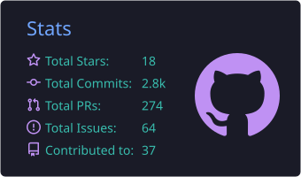
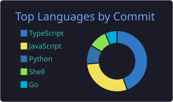
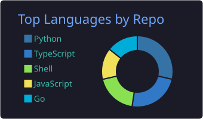
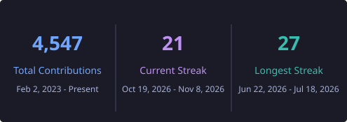

# Mohammed Firdous

Software Engineer working on cloud-native infrastructure, Kubernetes and AI platforms, mostly in Go and Python.

- Maintainer of [PipeCD](https://github.com/pipe-cd/pipecd) (CNCF Sandbox) and LFX mentor
- 2x AWS Community Builder for Serverless Category
- Portfolio: [mohammedfirdous.fyi](https://mohammedfirdous.fyi)
- Email: mohammedfirdous682[at]gmail dot com

I watch football and basketball occasionally when i have free time. A Man Utd fan :)

**Stack:** Go · Python · Kubernetes · Terraform · Docker · AWS · GCP · Linux

## Latest writing

<!-- BLOG-POST-LIST:START -->
- [MCPs and APIs](https://medium.com/@mohammedfirdousaraoye/mcps-and-apis-6d4d3559da63?source=rss-19706121782c------2)
- [Why a Serverless Mindset Matters](https://medium.com/@mohammedfirdousaraoye/why-a-serverless-mindset-matters-a0103642631a?source=rss-19706121782c------2)
- [Understanding Docker](https://medium.com/@mohammedfirdousaraoye/understanding-docker-fdfc1edf3bbd?source=rss-19706121782c------2)
- [3 Tier Architecture using AWS CloudFormation](https://medium.com/@mohammedfirdousaraoye/3-tier-architecture-using-aws-cloudformation-419044db9587?source=rss-19706121782c------2)
- [Navigating AWS with Confidence: A Beginner’s Guide to Amazon CloudWatch and Amazon Route 53](https://medium.com/@mohammedfirdousaraoye/navigating-aws-with-confidence-a-beginners-guide-to-amazon-cloudwatch-and-amazon-route-53-38e1225cf0f0?source=rss-19706121782c------2)
<!-- BLOG-POST-LIST:END -->

## GitHub Stats

